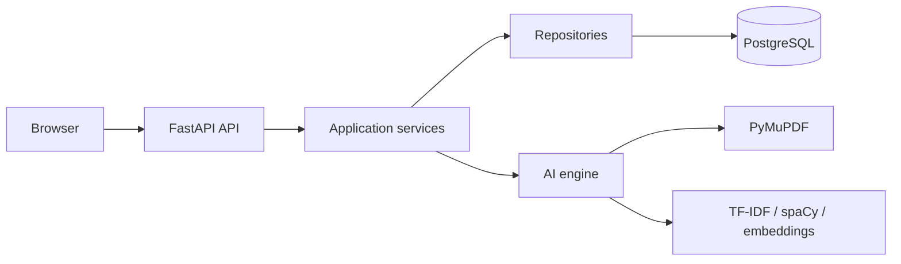

# CareerMatch AI architecture and roadmap

## Target module structure

```text
careermatch-ai/
├── backend/app/{api,core,db,schemas,services,ai}
├── frontend/src/{components,pages,services,types}
├── docs/
└── docker-compose.yml
```

The API layer will orchestrate use cases, while the AI package remains independent of HTTP. Repositories isolate persistence; Pydantic schemas isolate external contracts from SQLAlchemy models.

## Data flow



## Roadmap

1. Phase 1: initialization, health endpoint, PostgreSQL Compose wiring, frontend/backend shells, configuration, baseline test.
2. Phase 2: Alembic schema, authentication, user/profile APIs, ownership checks, frontend auth shell.
3. Phase 3: PDF upload/storage, extraction pipeline, CV and job offer management.
4. Phase 4: explainable deterministic matching, configurable weights, recommendations, analysis persistence, reports.
5. Phase 5: dashboard, history, charts, responsive UX, semantic Sentence Transformer enhancement, end-to-end coverage.
6. Phase 6: production hardening, observability, deployment guide, security review, and performance tuning.

The planned score measures textual alignment against job requirements. It must not infer protected or sensitive attributes, and it will report missing input explicitly instead of inventing evidence.

